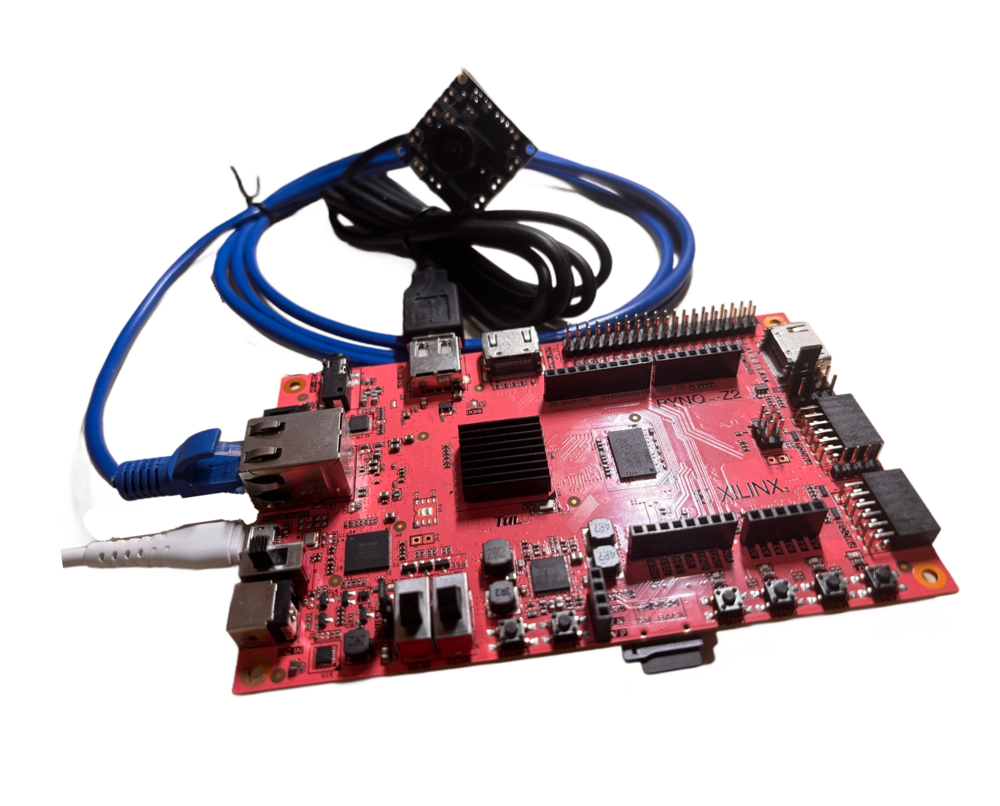
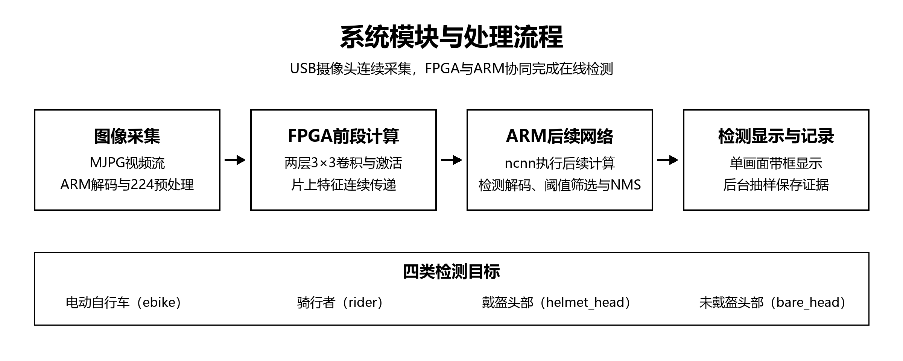
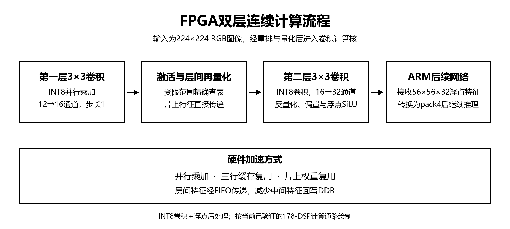
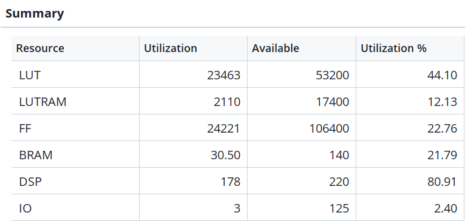
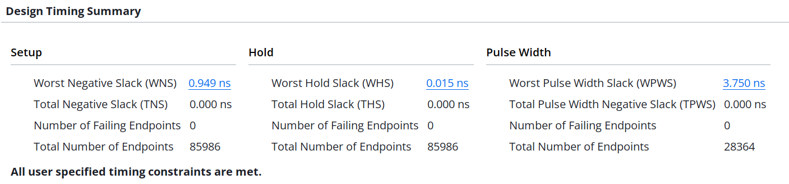
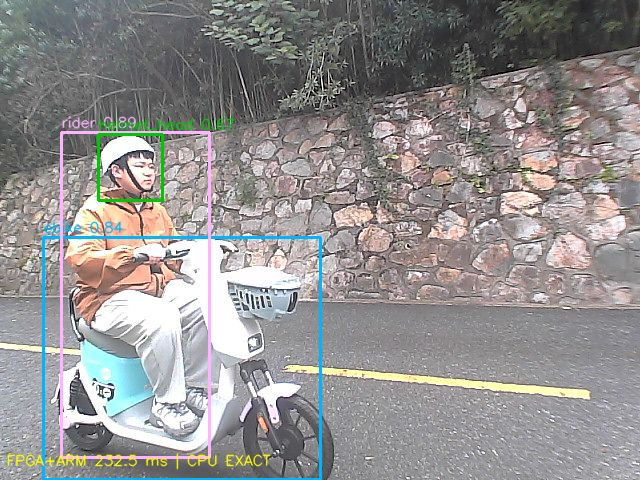

# 基于 PYNQ Z2 与 YOLOv5 的校园骑行头盔在线监测系统设计报告

全国大学生嵌入式芯片与系统设计竞赛 2026 FPGA 赛道 AMD 自主选题

平台 PYNQ Z2　器件 XC7Z020 CLG400 1　报告日期 2026 年 10 月 31 日

## 摘要

针对校园骑行中的头盔佩戴监测需求，团队以 YOLOv5n 为基础，在 PYNQ Z2 上实现摄像头持续采集、FPGA 与 ARM 协同推理、同帧检测显示和后台抽样存证。系统识别电动自行车、骑行者、戴盔头部和未戴盔头部。研发依次完成 NEON 格式转换、ncnn 运行时迁移、输入尺寸调整、INT8 与 FP32 混合精度部署，以及前两层卷积的片上连续计算；通过并行乘加、行缓存、权重复用和层间 FIFO 降低执行与传输成本。最终模型采用 55 个 INT8 卷积和 5 个 FP32 卷积，同输入离线完整 forward 从 CPU 的 204.27 ms 降至协同的 180.31 ms，延迟下降 11.73%。摄像头在显示提交、数值抽查与抽样存证同时运行时达到 2.4324 FPS；硬件占用 178 个 DSP，100 MHz 下通过实现时序检查。核心加速主线完成 17 批实验，五批云端训练合计 235 个 epoch。团队将排障、模型核验、卷积加速和视频调度经验提炼为32项技能，为同类边缘视觉系统提供可复用的设计与验证流程。

关键词　PYNQ；YOLOv5n；校园骑行；混合精度；卷积流水；视频流在线检测

## 目录

<!-- Word automatic table of contents -->

## 一、选题背景与创新点

### （一）从图像处理实验走向校园实际问题

校园内电动自行车通行频繁，骑行者是否佩戴头盔是可以通过视觉观察的安全要素。人工巡查难以持续覆盖同一入口和同一时段，因此我们希望在边缘端持续接入摄像头，把电动自行车、骑行者和头部状态转换为可查看、可回溯的检测结果，辅助安全宣传和现场管理。

团队前期学习的 FPGA 图像处理示例主要围绕缩放、颜色转换、图像边缘提取，以及去雾、去噪等基础环节展开。在掌握像素流与硬件接口后，我们希望进一步完成具有明确应用目标的持续视频处理任务。结合校内骑行安全需求，团队选择以 YOLOv5n 为基础，设计轻量化实时头盔检测系统，将摄像头输入、目标识别、板端计算和现场展示连接起来。

校园应用要求系统在有限算力和存储条件下持续工作，并及时给出骑行者及其头盔状态。为此，我们将研究重点放在 Zynq 7020 平台上的软硬件协同部署：既优化模型的计算与精度，也协调视频流、显示和存证之间的资源使用，使检测功能能够在实际装置上连续运行。

### （二）技术基础与项目定位

本项目以 YOLOv5n 的轻量目标检测结构为模型基础[1]，采用 PYNQ 的 Python 与 Jupyter 框架组织 PS 和 PL 协同运行[2]，使用 ncnn 的 ARM 推理能力完成板端网络部署[3]。在此基础上，团队围绕校园四类目标实现模型训练、量化配置、前段卷积加速、接口衔接及整机验证。

项目将优化目标落实到摄像头持续输入下的完整检测任务。我们根据逐层计时和器件资源，选择前两层连续子图作为 FPGA 加速对象，利用片上数据复用和层间流水缩短执行时间；剩余网络由 ARM 运行，兼顾网络拓扑适配和系统集成。每项改动均通过数值对照、完整路径计时与真实视频联调评价。

### （三）创新贡献与实际作用

第一，围绕校园骑行构建四类目标检测系统，将 USB 视频采集、板端推理、同帧画框和抽样留存接成连续通路。系统输出电动自行车、骑行者、戴盔头部和未戴盔头部信息，并保留对应画面，为校内头盔佩戴检查、安全宣传和现场管理提供辅助。

第二，实现包含输入重排、卷积、原激活及再量化、第二层卷积、浮点尾部处理的 PL 连续计算段。通过并行乘加、行缓存、片上权重和层间 FIFO，减少中间特征在 ARM 与 DDR 之间的传输，以同模型、同输入的完整 forward 对照确认实际收益。

第三，建立覆盖软件推理、混合精度、卷积硬件、摄像头流水线和云端训练的分层验证流程。团队将不同候选的计时、资源与检测表现归档，并据此提炼32项技能，固化瓶颈定位、计算量估算、接口核验和实验判断方法，帮助后续使用者提高视频流处理效率，完成卷积计算与板端资源预算。

## 二、设计原理与系统功能

### （一）系统组成与功能范围

系统由 PYNQ Z2、USB UVC 摄像头、SD 卡和通过以太网连接的电脑浏览器组成。实验阶段采用 USB 供电、SD 卡启动；Micro USB 同时承担板端供电及可用的串口连接，摄像头接板卡 USB HOST，网线用于访问 Jupyter。电脑承担开发、操作和显示，检测推理运行在板端。



图1　团队保存的系统实物照片　USB 摄像头连接板卡　网线连接上位机　系统从 SD 卡启动

系统提供连续取帧、四类检测、同帧带框显示、启动及周期 CPU 对照、后台抽样保存等功能。启动时核验模型与硬件文件，运行时记录相机帧号、检测结果和阶段耗时，结束时完成队列排空、资源释放与硬件恢复，形成可追溯的演示与测试流程。



图2　系统模块与处理流程　视频持续输入　FPGA 前段与 ARM 后段协同输出同帧结果

### （二）检测模型与输入输出契约

模型采用 YOLOv5n，固定四类顺序为 ebike、rider、helmet_head、bare_head。输入为 RGB、float32、NCHW 布局的 [1,3,224,224] 张量；原图为 640×480 BGR，最近邻缩放至 224×168，上下各填充 28 行、填充值 114，然后转为 RGB 并除以 255。输出形状为 [1,3087,9]，每条记录含四个框参数、目标分数和四类分数；当前导出输出已完成相应解码，不再重复 sigmoid。

后处理使用类别阈值 [0.35,0.25,0.50,0.20]、分类 NMS IoU 0.45，评估匹配 IoU 为 0.5。输出框按缩放与填边关系映射回 640×480 原图。模型接入时统一核对输入尺寸、插值、通道、类别顺序、量化尺度和解码方式，以保证训练、导出和板端运行采用一致的数据约定。

四类目标分别描述车辆、骑行者及头部佩戴状态，结果以框、类别和分数呈现，并与原图同步保存。系统面向固定机位下可见目标的在线检测；现场管理可结合保存画面进行复核，后续扩展可在此基础上增加多目标关联与连续状态判断。

### （三）视频流调度与存证

后台持续读取 MJPG 压缩帧，主循环选择最新可用帧并解码。采集速度高于检测速度时，使用更新帧替换尚未处理的旧帧，减少排队积压。每个被选中的帧保留相机帧号，输入、检测框、显示画面和抽样记录通过同一帧号关联。

主循环完成预处理、FPGA 与 ARM forward、解码 NMS、画框、一次 JPEG 编码及 Jupyter 提交。显示与保存共享同次编码结果，后台通过有界队列抽样保存原始 MJPG、无损 BGR 数组、实际输入张量、raw 输出、框和运行日志，以控制存储负载并保留复核所需数据。

新模型 30 秒短测后台收到 289 帧，选择 73 帧检测，等待期间更新替换 212 帧，结束时剩余 4 帧。共保存 15 组证据，保存队列无丢弃。日志分别记录采集选帧、旧帧替换和保存队列状态，便于分析时延与存证完整性。

## 三、软硬件划分与接口设计

### （一）划分依据

逐层计时表明卷积和 SiLU 等算子占据主要推理时间。早期 320 FP32 模型的探针结果显示：第一层 6×6 卷积约 171.15 ms，所有 1×1 卷积合计约 169.24 ms，步长 2 的 3×3 卷积合计约 166.62 ms，Swish 约 96.25 ms。团队以这组历史模型的分项数据确定优先优化方向，并在最终 224 模型上重新验证完整收益。

单层实验表明，量化、布局转换、缓存同步、DMA 和回传共同构成子图边界成本。因此，最终将相邻两层及其激活、量化连接在 PL 内，在连续子图的输入和输出边界与 ARM 交换数据。包含分支、拼接及 FP32 敏感层的后续网络由 ncnn 执行，以发挥规则卷积硬件与软件推理框架各自的优势。

表1　软硬件任务划分

| 环节 | 执行位置 | 划分理由与验证对象 |
|---|---|---|
| MJPG 采集与 JPEG 解码 | PS ARM | 复用 UVC 与软件解码　独立统计开销 |
| 224 缩放 填边 RGB 与布局转换 | PS ARM | 最终入口沿用已核验软件预处理 |
| 输入量化与 Reorg 前两层卷积 | PL | 规则密集计算　使用 DSP 并行乘加和片上缓存 |
| 层间激活与再量化 浮点尾部 | PL | 保持原算子语义　减少中间回传 |
| 后续 58 个卷积及网络操作 | PS ARM ncnn | 支持复杂拓扑及五个 FP32 敏感卷积 |
| NMS 画框 JPEG 与 Jupyter | PS ARM | 结果组织与显示　与推理分开计时 |
| 抽样保存与文件身份检查 | PS ARM SD | 有界队列　不可变快照　可追溯记录 |

NEON 是 Cortex A9 的向量指令机制，ncnn 是支持 ARM NEON 的推理框架。项目先用 NEON 加速预处理中的格式转换，再将完整网络推理从 OpenCV DNN 迁移至 ncnn，并继续在 ncnn 和桥接代码中使用 NEON。预处理硬件与前两层卷积硬件按各自输入输出约定独立管理。

### （二）FPGA 连续计算原理

原始首层为输入 3 通道、输出 16 通道的 6×6、步长 2 卷积。通过等价重排，将 224×224×3 输入组织为 112×112×12，再执行 3×3、步长 1 卷积。重排保持输入信息、权重对应关系和数学乘加总数，同时改善计算核的数据组织与访存方式。第二层为 16→32 通道、3×3、步长 2，输出为 56×56×32。



图3　FPGA 双层连续计算　两层之间通过片上缓存和 FIFO 衔接

卷积使用 INT8 乘法和 INT32 累加。行缓存保留相邻行，构建 3×3 窗口，避免为每个输出重新从 DDR 读取全部邻域。权重存储通过分区提供并行读端口，输入通道和输出通道分组并行；部分和在归约完成前保留。HLS DATAFLOW 连接各处理阶段，FIFO 深度和生产消费数量需满足背压条件。

第一层之后依据真实 ARM 算子采集可达范围，生成保持原激活和再量化结果的精确映射。第二层之后完成反量化、偏置和浮点 SiLU，保持与当前 ARM 参考一致的算子语义。权重和映射与模型版本配套保存，更新权重时同步生成常量、IP 与匹配的 bit/hwh。

### （三）计算量与资源预算

普通卷积的乘加数按输出高×输出宽×输出通道×输入通道÷groups×卷积核高×卷积核宽计算。本报告以一次乘加记一个 MAC；按乘法与加法分别计数时，对应约两倍 operations。

首层为 112×112×16×3×6×6，即 21676032 MAC；重排后的 112×112×16×12×3×3 与其相同。第二层为 56×56×32×16×3×3，即 14450688 MAC，两层合计 36126720 MAC。输入边长由 320 减为 224 后，固定拓扑的空间计算量约降至原来的 0.49。团队结合小头部检测结果评估该尺寸配置，并通过后续数据补强和针对训练改善小目标表现。

INT8 量化降低权重存储需求和单次运算代价，并行乘加缩短卷积执行周期，行缓存提高邻域数据复用率，层间流水减少中间特征传输与调度开销。团队结合乘加阵列、地址控制和浮点尾部的资源需求进行预算，并以布局布线后的实现报告核定 DSP 占用。

### （四）PS 与 PL 接口契约

表2　PS 与 PL 接口约定

| 接口 | 当前设计约定 | 检查要求 |
|---|---|---|
| 控制 | AXI Lite 控制宽高 启动与状态 | 使用匹配 HWH 解析地址与寄存器 |
| 输入流 | 32 位 AXI Stream 打包 RGB 字节 | 有效字节 224×224×3 为 150528　长度以字节配置 |
| 输出流 | float32 HWC 特征 56×56×32 | 100352 个元素　有效负载 401408 字节 |
| ARM 续算边界 | HWC 转自有内存 pack4 后交 ncnn | 通道排序 padding dtype 与所有权分别核验 |
| 完成条件 | DMA 双向完成且计算 IP 完成 | 检查错误位 实际接收长度 超时和保护区 |
| 缓存 | 发送前同步到设备 接收后同步到 CPU | 分别执行设备侧与 CPU 侧缓存同步 |
| 时钟 | FCLK0 100 MHz | HWH 实际位流与工具报告身份一致 |

DMA 接收端先就绪，再按已验证顺序启动输入与计算。异常处理保留状态、传输长度和超时信息，确认 DMA 静止后释放 CMA 或切换位流。正常退出分别记录相机停止、线程排空、DMA 静止、缓冲释放和旧硬件恢复状态，保证完整运行周期可检查。

## 四、推理与卷积优化过程

### （一）实验轮次的统计口径

实验按已回传并保存的技术结果包计批，批内另列配置数、输入组数和重复计时次数。统计时根据内部会话与结果身份合并重复归档；版本号、训练 epoch、仿真用例和现场帧数分别记录。

截至双层接入整网阶段，核心主线共 17 批：运行时及量化相关 7 批，卷积参考、实现、诊断及整网接入相关 10 批。第 17 批内为 3 轮、每轮 12 个样例，CPU 和 FPGA 各 36 次计时；首层重排与 stride 选路两批每版本各测 108 次。十七批实验的内容、配置与计数见附录 A，完整记录随材料包提供。

### （二）早期预处理的四阶段优化

早期预处理按照完整路径计时，终点先是 RGB 图像，之后扩展为模型张量。Python 逐像素打包和解包导致 DMA 加 PL 很快、完整路径却很慢。我们先拆分输入打包、DMA 与硬件、输出解包，再比较 OpenCV、C 和 NEON，最后融合 RGB 输出与 NCHW 归一化，省去中间数组。

表3　预处理四阶段优化结果

| 阶段及终点 | 基线 | 候选 | 测试与结论 |
|---|---:|---:|---|
| P1 初始完整 RGB 路径 | 软件 9.695 ms | PL 完整 119.685 ms | 固定图像 30 次　像素一致　定位格式转换开销 |
| P2 分项诊断 RGB | 完整 73.481 ms | DMA 与硬件仅 4.535 ms | 输入 43.196 ms 输出 25.750 ms　瓶颈在接口 |
| P3 OpenCV 与 NEON RGB | 17.647 ms | 11.115 ms | 每路径 30 次　完整路径下降 37.0% |
| P4 旧两步与融合 NEON 张量 | 14.676 ms | 12.852 ms | 每路径 30 次　同终点下降 12.4% |

P3 中输出解包从 8.678 ms 降至 2.193 ms，下降 74.7%。P4 对照中，融合 NEON 张量路径为 12.852 ms，融合 C 路径为 24.341 ms，同轮软件路径为 7.716 ms。根据相同终点的测试，团队采用 NEON 改善转换效率，并在后续整机中选择成本较低的软件预处理，将 PL 资源集中用于前段卷积。P3 以 RGB 图像为终点，P4 以 float32 模型张量为终点。

早期预处理还完成 20 帧变化输入的上板验收。团队分别以固定图像 30 次计时评价稳定开销，以变化输入检查接口与像素一致性；相关结果保存在预处理笔记、截图转录表和验收记录中。

### （三）从 OpenCV DNN 到 ncnn

原 OpenCV DNN 双线程推理约 1879.86 ms。保持四类模型和 320 FP32 输入后，迁移到 ncnn，双线程均值为 743.86 ms，单线程为 1344.66 ms；双线程 12 组参考核验通过，因此选用双线程。运行时迁移的观测速度比约 2.53，均值延迟下降约 60.4%。该数据不含摄像头与展示。

随后筛选六种卷积配置，初筛默认约 768 ms、最快约 739 ms。结合逐层计时，团队将后续优化集中在首层、stride 卷积和 Swish 等热点：先做首层等价重排，三轮对照中 765.07→637.63 ms，延迟下降 16.66%；再为六个步长 2 的 3×3 卷积选择实现，634.69→617.45 ms，下降 2.72%。两批每版本均测 108 次，统计由原始计时列表复算。

Swish 优化同时形成候选工具。以下性能汇总采用具有完整板端回传记录的运行时、卷积选路、量化和硬件接入实验。

### （四）从 FP32 到 INT8 再到混合精度

我们先在 320 输入上开展 INT8 板端探索，首个样例完成 3 次计时，平均约 400.56 ms，同时记录跨平台 raw 输出差异。随后采用同批 12 组输入、三轮重复的方式比较 224/256 与 FP32/INT8，并用 37 张开发图检查检测变化，使速度评价和任务评价同步推进。

表4　输入尺寸与定点化对照

| 方案 | 平均 forward ms | P95 ms | 每版本计时次数 | 解释 |
|---|---:|---:|---:|---|
| 320 FP32 同批对照 | 603.28 | 614.66 | 36 | 本轮运行状态下的对照 |
| 256 FP32 | 388.68 | 396.87 | 108 | 缩小输入 |
| 256 INT8 | 263.80 | 271.86 | 108 | 卷积定点化 |
| 224 FP32 | 311.64 | 313.28 | 108 | 保持浮点的较小输入 |
| 224 INT8 | 201.10 | 203.12 | 108 | 速度与37张开发图同步评价 |

同为 224 输入，311.64→201.10 ms 对应量化后的延迟下降约 35.47%；320 FP32 到 224 INT8 的整体演进则包含尺寸缩小与量化两项收益。同批原 320 与 224 INT8 的未戴盔 TP 为 7→5、戴盔 TP 为 21→16，据此，团队继续通过敏感层恢复寻找速度与头部检出的平衡。

表5　混合精度敏感层恢复对照

| 混合精度候选 | 恢复 FP32 的卷积数 | 平均 ms | 戴盔 TP 共25个 | 未戴盔 TP 共13个 | 未戴盔 FP |
|---|---:|---:|---:|---:|---:|
| 同轮 INT8 对照 | 0 | 205.62 | 16 | 5 | 0 |
| recover1 | 1 | 203.87 | 17 | 4 | 0 |
| recover5 | 5 | 206.03 | 18 | 5 | 1 |
| recover17 | 17 | 223.90 | 18 | 5 | 0 |

四版本各测 108 次。recover5 将 conv_6、conv_11、conv_57、conv_58、conv_59 恢复为 FP32，最终形成 55 个 INT8 与 5 个 FP32 卷积，以约 206 ms 的平均耗时提高部分头部检出。部署时冻结真实 ARM 输出作为硬件数值参考，同时保留 PC 与 ARM 的量化输出对照，用于后续模型适配分析。

校准、敏感层选择和部署分阶段执行。最终模型重新训练后，团队重新生成校准尺度、混合精度模型和匹配硬件常量。导出材料包含来自训练集的 128 张校准图，开发验证图与测试图按原分组独立保留；量化模型在实际 ARM 环境中进行检测结果核对后接入系统。

### （五）单层卷积到双层连续计算

单层首版保持 INT8×INT8→INT32，通过边界、极值和真实输入检查数值。原始 DMA 窗口约 22.42 ms，整数准备、DMA 与回读约 30.90 ms。随后将输出通道并行度 8→16、输入通道并行度 3→6，名义并行乘法 24→96，实现占用 96 DSP，两组完整尺寸原始 DMA 窗口合并均值约 10.41 ms。团队随后继续测量浮点转换与整网接入成本。

将浮点输入量化、重排、反量化和 bias 纳入后，完整首层约 30.71 ms。NEON 转换候选完整耗时约 31.73 ms，直接搬运与整块搬运分别约 31.11、34.46 ms。分项结果表明子图边界仍是主要成本，因此优化方向进一步转为相邻层连续计算，减少中间数据转换和回传。

双层方案将输入量化/Reorg、Conv0、精确激活与再量化、Conv1、反量化/bias/浮点 SiLU 连续留在 PL。历史旧权重实现使用 173 DSP，12 组、27 次上板运行逐位检查通过；完整尺寸硬件段约 7.74 ms，连准备、搬运与回读约 11.66 ms。接入整网后三轮 CPU 与协同路径各测 36 次，均值 214.55→185.51 ms，下降 13.54%；返回的 120 份数组经独立复核，硬件边界和整网输出一致。

重新训练后，团队按相同设计方法重新生成常量及位流，综合映射后的 DSP 占用由 173 变为 178。新模型同图复测按旧→新→新→旧顺序收集 192 次计时，每模型 CPU 与协同各 48 次。新模型 CPU 平均 204.27 ms，协同平均 180.31 ms，延迟下降 11.73%；旧模型协同为 183.59 ms。

### （六）后续计算核与 ARM 配置探索

在十七批核心实验基础上，团队继续开展 ARM 续算、并行 MAC、批量调度 V2、完整层对照、B 候选以及 V3 整层流式实验。后续记录分别组织计算核、完整层和整网评价，用以确定各候选适合的计算粒度与调度方式。

43 DSP 独立核采用 8 个输出 PE、每个 PE 4 路输入乘法，并缓存输入和权重，采用独立镜像配置运行。完整层 V3 使用 18 DSP、紧凑输入与行缓存、一次整层启动和 pack4 输出，完成数值检查。计入搬运与 ARM 后处理后，三层中位耗时分别为 ARM 4.34/3.50/2.73 ms、V3 15.36/9.87/7.03 ms。根据整层结果，系统选择 178 DSP 双层连续通路，V3 记录用于指导后续数据复用与边界优化。

ARM 续算另测 5 种配置，每配置 36 次，共 180 次。显式内存池均值为 156.94 ms，开头基线为 157.60 ms；结合中位数、P95 和基线漂移，团队保留原双线程及等待策略，将后续优化重点放在更稳定的整段收益上。

## 五、摄像头联调与帧率优化

### （一）从串行验证循环定位瓶颈

最初循环依次完成取帧、FPGA 与 ARM 推理、CPU 对照、PNG/JPEG 编码、文件保存及哈希、报告更新和显示。整网 forward 约 220 ms，整机约 0.73 FPS。分项诊断显示，原图 PNG 编码约 579 ms/帧，逐帧 CPU 对照约 241 ms，写入及关闭调用约 14 ms。团队据此优先调整编码、核验频率与存证调度。

摄像头优化累计完成七批正式回传：首次真实 FPGA 摄像头验证、取帧存储三模式诊断、MJPG 去 PNG 六模式、独立预览分离、新模型单画面短测、JPEG 质量三模式、动态曝光帧率 A/B。对焦只读记录单独用于画质诊断，骑车实测按内部会话归档，保证各批试验内容和计数清晰。

### （二）优化前后对照

表6　摄像头联调与模式对照

| 批次与模式 | 检测 FPS | 主要改变 | 结论 |
|---|---:|---|---|
| C1 初次摄像头逐帧核验 | 约0.75 | 逐帧 CPU 对照与重型存证 | 跑通真实 FPGA 通路 |
| C2 串行诊断 | 0.7277 | 拆分编码 写入 推理 显示 | PNG 为主要额外开销 |
| C2 后台全存 | 约0.75 | 后台取帧及保存 仍编码 PNG | 进一步优化PNG编码负载 |
| C2 轻量模式 | 1.1943 | CPU 抽查与抽样存证 | 提升约64%　仍有编码负载 |
| C3 MJPG 去 PNG 后台抽样 | 2.4075 | 最新压缩帧 一次 JPEG 无损数组存证 | 对轻量模式约2.02倍 |
| C4 独立原始预览分离 | 1.1423 | 原始预览与检测双路发布 | 对照后选择单画面通路 |
| C5 新模型单画面 | 2.4324 | 匹配新模型与178 DSP 保留单画面 | 73帧约30秒　当前基线 |
| C6 JPEG Q80 640宽 | 2.3867 | 单画面质量对照 | 48帧约20秒 |
| C6 JPEG Q60 640宽 | 2.4407 | 降低末端 JPEG 质量 | 字节减少约48.6% |
| C6 JPEG Q60 480宽 | 约2.29 | 增加末端缩放 | 缩放约47 ms 抵消收益 |

经过取帧、CPU 抽查、编码和后台存证的组合优化，检测结果更新率从阶段初期的 0.7277 FPS 提高到 2.4075 FPS，约为原来的 3.31 倍。更新模型后，单画面通路达到 2.4324 FPS。各阶段按实际模型、显示方式与存证负载记录测试条件，单因素收益则采用同批 A/B 对照评价。

仅取帧测试中，MJPG 约 10.03 FPS，YUYV 约 11.65 FPS。系统选择 MJPG 以减少压缩帧传输负载，并支持直接利用原 JPEG 进行预览；该预览提交约 10.05 次/秒。报告分别记录采集返回率、预览提交率和检测结果更新率，以描述视频链路的各个阶段。

### （三）最终系统时间构成

表7　新模型摄像头计时分解

| 顶层分项 新模型73帧短测 | 平均或摊销 ms | 计时说明 |
|---|---:|---|
| FPGA 与 ARM 整个 forward | 215.20 | 包含输入打包 DMA 和 ARM 后续 |
| 其中 ARM 续算合并段 | 186.86 | forward 内子项 |
| 其中 DMA 窗口 | 7.82 | forward 内子项 |
| 所选 MJPG 解码 | 41.10 | 每个检测帧 |
| 224 预处理 | 17.51 | 每个检测帧 |
| 检测解码与 NMS | 21.14 | 每个检测帧 |
| 画框文字与复制 | 9.03 | 每个检测帧 |
| JPEG 编码 | 31.77 | 同帧编码一次 |
| Jupyter 提交 | 30.17 | 板端发布接口计时 |
| CPU 抽查摊销 | 26.16 | 运行期共抽查8帧 |
| 诊断报告序列化与写入摊销 | 13.93 | 按实际写入次数摊销 |
| 主循环平均 | 411.00 | 包含少量其他开销 |

后台保存平均约 175.73 ms/被选存证组，以抽样方式与主线程并行执行。forward 中位数为 207.66 ms，P95 为 241.38 ms，最大值为 388.25 ms。软件记录的取帧返回至带框图提交平均耗时为 451.94 ms，测量边界覆盖板端取帧返回、处理与显示提交。

### （四）画质和候选路径的取舍

JPEG 质量试验中，Q80→Q60 的当轮平均字节约 76967→39533，减少约 48.6%，FPS 从 2.3867 到 2.4407。该项优化作用于末端编码和传输负载；480 宽候选的额外缩放约 47 ms，因此采用 640 宽通路。画质诊断进一步从原始 MJPG 检查焦距和曝光，在实际距离固定机位和镜头清晰度。

动态帧率开关 A/B 中，取帧返回率约 9.91 与 9.59 FPS，测试后保留原控制设置。JPEG 软件对照采用 4 图、160 次计时，OpenCV 约 28.57 ms，Pillow 同配置约 76.22 ms，系统据此选用 OpenCV。JPEG 硬件和原字节直传加浏览器绘框保留为后续候选，当前性能表采用已完成整机测试的单画面通路。

## 六、云端训练与准确率优化

### （一）云 GPU 与数据组织

早期本地 CPU 训练效率低，团队先探索 Kaggle 云 GPU，再在 AutoDL 环境完成可追溯的联合训练。五批正式结果记录的 GPU 为 NVIDIA GeForce RTX 4090，PyTorch 2.5.1+cu124，CUDA 12.4，固定 224 输入、batch 32、AdamW、seed 42。此前 Kaggle 初训属于初始模型来源，不混入以下五批联合训练的 epoch 总数。

校园素材按原采集会话分组组织。第二轮选取按原采集会话分组的校园训练 65 张，其中 52 张有标注、13 张空场；校园开发验证 23 张，其中 9 张有目标、14 张空场。重复打包的骑车实测 ZIP 按内部会话及图像身份去重。对于仅有头部标签的数据，按其标注范围设置监督目标，保留车辆与人物的未标注区域处理规则。

### （二）五批训练及实际 epoch

表8　五批云端训练配置与轮次

| 批次 | 训练图像条目 | 最大计划 epoch | 实际完成 epoch | 主要变化 |
|---|---:|---:|---:|---|
| T1 联合训练第一轮 | 1000 | 50 | 11 | 从初始模型微调　先建立固定224比较 |
| T2 校园场景加入 | 1065 | 40 | 17 | 加入65张校园训练　修复验证加载而不重训 |
| T3 扩充与尺度补强 | 1769 | 40 | 14 | 1665原条目加104训练派生　补充小头部 |
| T4 头部针对训练 | 2531 | 80 | 43 | 扩展头部数据与权重　固定流程瓶颈选模 |
| T5 最终完整训练 | 3289 | 150 | 150 | 禁用早停　3029原条目加260派生 |

根据五份 results.csv，五批训练共完成 235 个 epoch，计划上限合计 360。前四批启用早停，最终批完整训练 150 个 epoch。数据表分别记录原始与派生条目。

T3 保持原超参数并扩展样本，加入训练内尺度变化以覆盖小头部。T4 对头部损失设置 1.5 权重、最小边不超过 12 像素的小头部设置 3 倍权重；学习率由 3e-5 调为 2e-4，box 与 cls 权重分别调整为 0.075、0.75。T5 将不完整标签区域的 objectness 权重进一步由 0.15 降至 0.03，设置小头部 objectness 下界 0.25，采用余弦学习率并保留每 25 个 epoch 的检查点。各轮训练保持现场 224 输入和单尺度推理配置，将改进集中在样本、损失权重和选模策略。

第四轮按固定 224 的任务指标选中 epoch22（第 23 个 epoch），最终批选中 epoch29（第 30 个 epoch）。该候选用于导出与上板，团队同时保存最终 last 与周期检查点。

### （三）同一校园开发集的逐轮结果

以下结果采用固定阈值、224 输入的 FP32 开发验证流程。各格为 TP/FP/FN，校园开发组包含电动自行车 9、骑行者 8、未戴盔头部 7 个标注目标，用于逐轮分析训练变化。

表9　校园开发集逐轮检测结果

| 版本 | 电动自行车 | 骑行者 | 未戴盔头部 |
|---|---|---|---|
| 初始 FP32 参考 | 7/1/2 | 1/2/7 | 0/0/7 |
| T1 best | 6/2/3 | 4/3/4 | 0/0/7 |
| T2 best | 7/1/2 | 4/3/4 | 1/0/6 |
| T3 best | 9/1/0 | 6/4/2 | 1/0/6 |
| T4 best | 8/1/1 | 8/2/0 | 3/1/4 |
| T5 best FP32 | 9/1/0 | 8/1/0 | 3/1/4 |

T5 相较初始参考，电动自行车 TP 从 7 提高到 9，骑行者 TP 从 1 提高到 8，未戴盔头部 TP 从 0 提高到 3；骑行者召回由 12.5% 提高到 100%，未戴盔召回提高到 42.9%，未戴盔精确率为 75.0%。团队结合各类目标的逐轮结果选模，戴盔目标另在包含对应正样本的数据组中评价。

### （四）浮点训练结果与实际部署的差异

表10　实际 ARM 环境的模型检测对照

| 同一校园23张的实际 ARM 对照 | 电动自行车 TP/FP/FN | 骑行者 TP/FP/FN | 未戴盔 TP/FP/FN |
|---|---|---|---|
| 旧混合精度板端模型 | 4/0/5 | 0/1/8 | 0/0/7 |
| 新训练 FP32 参考 | 9/1/0 | 8/1/0 | 3/1/4 |
| 新训练混合精度部署 | 9/2/0 | 7/2/1 | 2/2/5 |

最终混合精度板端模型的骑行者召回为 87.5%，未戴盔召回为 28.6%。校园组的 14 张空场均无框；在 9 张有目标画面中，FP32 有 4 张达到整图目标全部匹配且无多余框，混合版为 3 张。团队分别记录目标级 P/R、空场表现与整图结果，为后续小头部补强和量化敏感层优化提供依据。

最终 FP32 在旧四类 37 图中的戴盔 TP/FP/FN 为 21/11/4，P=65.6%、R=84.0%；头部 519 图中的戴盔结果为 259/160/267，P=61.8%、R=49.2%。各数据组按照自身标注范围统计。训练日志保留标准 mAP，固定阈值评价保留 P/R，现场记录保留整图匹配情况，共同描述模型在不同条件下的表现。

### （五）导出与兼容纠错

最终浮点模型先导出 TorchScript 与 ncnn，再进行校准、混合精度转换和硬件常量准备。实际 ARM 接入中出现 CopyTo 算子兼容问题。我们验证图复制与别名语义后，改为等价 Slice/Concat；电脑端 1158 组模型与图片输出逐字节一致，再采集两组真实 ARM 前段与整网参考，随后重建匹配的 178 DSP 位流。

图等价修复后，新版本依次完成 ARM 数值参考采集、匹配硬件重建、同输入测速和摄像头验证，再进入当前演示入口。模型、硬件和性能结果通过版本身份对应保存。

## 七、性能资源与功能验证

### （一）优化前后性能对照

表11　主要阶段性能对照

| 比较内容 | 优化前 | 优化后 | 观测收益与范围 |
|---|---:|---:|---|
| 320 FP32 推理运行时 | OpenCV约1879.86 ms | ncnn743.86 ms | 约2.53倍　历史迁移比较 |
| 同轮首层重排 | 765.07 ms | 637.63 ms | 延迟下降16.66% |
| 同轮 stride 实现选路 | 634.69 ms | 617.45 ms | 延迟下降2.72% |
| 同批224 FP32与INT8 | 311.64 ms | 201.10 ms | 延迟下降35.47%　检测结果改变 |
| 旧模型双层协同整网 | CPU214.55 ms | 协同185.51 ms | 延迟下降13.54% |
| 新模型双层协同整网 | CPU204.27 ms | 协同180.31 ms | 延迟下降11.73%　同输入48次各路径 |
| 摄像头通路阶段比较 | 0.7277 FPS | 2.4075 FPS | 约3.31倍　组合优化短测 |
| 新模型摄像头基线 | 整机配置形成 | 2.4324 FPS | 73帧30.011秒　完整通路短测 |

从早期 OpenCV 运行到最终协同部署，系统依次获得运行时迁移、尺寸调整、混合精度和连续卷积加速的阶段收益。表中各行注明对照范围，其中 FPGA 对新模型完整 forward 的贡献由同输入 CPU 204.27 ms 与协同 180.31 ms 的对照确认，摄像头吞吐则在完整采集、显示与存证循环中单独测量。

### （二）实现资源与时序

表12　各阶段硬件实现资源与时序

| 对应硬件 | DSP | LUT | FF | BRAM36 Tile | 时钟 MHz | WNS ns |
|---|---:|---:|---:|---:|---:|---:|
| 单层并行 V2 | 96 | 11188 | 13780 | 13 | 100 | 0.787 |
| 旧权重双层连续段 | 173 | 23937 | 24481 | 30.5 | 100 | 0.953 |
| 新模型正式双层段 | 178 | 23463 | 24221 | 30.5 | 100 | 0.949 |
| 独立可复用 MAC 原型 | 43 | 7297 | 10230 | 26.5 | 100 | 0.562 |
| 整层流式 V3 实验 | 18 | 8767 | 12009 | 35 | 100 | 0.268 |

表中列出不同阶段的独立硬件配置。最终 178 DSP 占器件资源 80.91%，BRAM 占 21.79%，LUT 占 44.10%，FF 占 22.76%；两个卷积实例分别约占 84 和 94 DSP。团队依据布局布线后的实现报告统计资源，并结合对应任务范围、时序和完整执行时间评价配置。



图4　最终 178 DSP 位流对应的实现后资源利用率



图5　最终实现时序　WNS 0.949 ns　WHS 0.015 ns　脉宽裕量 3.750 ns

最终实现在 100 MHz 约束下通过建立、保持和脉宽检查，路由错误为 0。项目保留完整综合、实现与工具诊断报告，便于后续复查 PS DDR 配置和 DSP 流水设置。资源与时序是本次硬件实现的主要评价指标。

### （三）数值正确性与现场功能

验证依次覆盖软件黄金参考、仿真、实现、真实板卡、整网和摄像头。整数、打包和约定逐位一致的浮点边界采用精确比较，导出浮点对照按预先约定的 atol/rtol 检查。数值检查与性能计时分别记录，周期 CPU 抽查按实际执行次数摊销计入整机负载。

新模型 73 帧短测在启动阶段完成 12 组 FPGA 整网输出与 ARM 冻结参考的一致性检查，运行阶段抽查 8 帧，输出一致。保存的 15 组 BGR 可重建实际输入张量，raw 输出重新后处理与保存框一致；92 份 NPY 的形状、类型和有限值检查通过。73 帧 DMA 状态、长度和范围检查通过，退出与旧位流恢复成功。



图6　校园戴盔骑行场景检测结果　电动自行车　骑行者　戴盔头部

现场错例分析将类别判别与硬件数值验证分开进行。例如，室内裸头场景出现戴盔与未戴盔重叠框时，CPU/FPGA 输出保持一致，团队据此将改进重点放在类别冲突样本、小目标标注与训练策略，推动问题从定位进入模型改进。

## 八、大模型协作记录与自我纠错

### （一）协作角色与工作流

团队负责确定校园应用、提供板卡和真实拍摄、执行上板步骤、保存结果并选择运行方案。大模型协助阅读源码、确定接口、估算计算量、编写 HLS/PS 代码和测试工具、分析返回数据、整理交接与复现文档。每项候选经过对应层级的实验后形成采用或调整决定。

协作采用“问题描述→读取材料→提出假设→建立候选与对照→执行板测或云训练→回传原始文件→复算统计与核验身份→选择配置→沉淀技能”的闭环。模型计算、硬件接入和应用联调按任务分工推进。原始运行上下文记录的模型标识包括 gpt-5.6-sol 和 gpt-6.1-sol，协作附件保留相应时间与会话信息。

本章依据两段持续研发会话整理，按运行时迁移、混合精度、连续卷积、视频调度与云端训练等技术任务组织内容。配套协作记录保留原始提示词、模型回答、时间戳与对应实验记录。

### （二）技术任务与验证结果

团队围绕计算热点、数据通路与模型部署组织协作，逐项给出技术约束、候选方案和验收方法。下表按研发任务归纳提示词目标与后续验证结果，原始交互记录随附件保存。

表13　大模型协作技术任务与验证结果

| 记录 | 技术任务与约束 | 协作方案 | 验证结果与技术决策 |
|---|---|---|---|
| L01 | 分解格式转换与 DMA/PL 开销，定位预处理全链路瓶颈 | 建立打包、传输、解包计时及像素一致性检查 | 定位转换成本；NEON 输出解包由 8.678 降至 2.193 ms |
| L03 | 固定模型与 320 输入，对照推理框架及线程配置 | 建立独立 ncnn 路径，完成输出核验和单/双线程对照 | OpenCV 1879.86→ncnn 743.86 ms，选择双线程 |
| L04 | 评估小卷积核分块变换、边界重叠与数据复用 | 按 1×1、3×3 和首层结构分析变换及访存成本 | 形成按层选择实现的路线，结合逐层计时推进选路 |
| L05 | 固定 224 输入与阈值，搜索影响头部检出的 FP32 敏感层 | 对照恢复 1/5/17 层的耗时及 TP/FP/FN | 选择 recover5：55 层 INT8、5 层 FP32，均值 206.03 ms |
| L06 | 减少层间回传，在 PL 内衔接卷积、激活和再量化 | 设计 DATAFLOW 连续子图，以片上缓存和 FIFO 传递特征 | 12 组 27 次逐位核验；旧模型整网 214.55→185.51 ms |
| L07 | 协调采集、推理、显示和存证，控制视频处理积压 | 采用最新 MJPG、单次 JPEG、有界队列及周期 CPU 对照 | 检测更新率 0.7277→2.4075 FPS，输入与显示保持同帧 |
| L08 | 组织云 GPU 训练、校园样本扩充与固定 224 选模 | 统一数据分组、训练配置、损失权重与逐类评价 | 五批共 235 epoch；新 FP32 校园骑行者 TP 由 1 提高到 8 |
| L09 | 针对 1×1、3×3 与 SiLU 研究通道复用、行缓存及算子衔接 | 对照 ARM 执行路径、独立 MAC 和 V3 完整层成本 | 系统采用 178 DSP 双层通路，V3 记录指导后续调度改进 |
| L12、L13 | 提炼参数化操作流程、输入契约、验收方法与迁移条件 | 按环境、接口、模型、视频、性能和卷积拆分技能 | 先形成6项通用技能，再整理26项项目技能；两套工具分别完成35项和34项主机检查 |

实验反馈用于修正候选配置：以相同输入核对数值，以完整路径评价速度，以对应实现报告核定资源。协作产物包括计算代码、测试脚本、原始结果、版本清单与技能包，便于追溯每项技术决策。

### （三）自我纠错轨迹

第一类修正围绕计时边界。预处理诊断从 DMA 与硬件窗口扩展到完整路径，定位 Python 打包与解包成本，并统一 RGB 图像和最终张量两种终点。整机分析进一步将 ARM 续算归入 forward 子项，将后台保存记录为并行支路，建立清晰的计时树。

第二类修正围绕优化假设。团队对线程、NEON 转换、预览发布和 JPEG 编码逐项比较，以完整耗时决定配置。后台 PNG、单层转换和 V3 整层实验促使优化方向转向轻量存证、连续子图和数据复用；JPEG 编码最终选用实测较快的 OpenCV 路径。

第三类修正围绕接口与版本一致性。CopyTo 兼容问题通过图等价验证和 Slice/Concat 替换解决；训练权重更新后同步重建硬件常量与位流；资源统计采用实现报告。构建与上板记录按同一文件哈希关联，使模型、硬件与验证结果保持对应。

第四类修正围绕评价方法。团队分别组织 FP32 与混合精度检测评价、CPU/FPGA 同输入数值验证，以及摄像头完整路径测速。开发集 P/R、训练 mAP、空场表现和现场整图匹配按各自定义记录，使优化决定能够同时参考任务质量、运行速度与硬件一致性。

## 九、32项技能的提炼与复用

### （一）六项通用方法与二十六项项目技能

团队先整理6项通用PYNQ技能，再围绕本项目形成26项项目技能，共32项。通用区位于skill/general，覆盖板卡排障、Overlay/DMA、模型数值核验、摄像头流水线、性能分析和卷积加速。项目区位于skill/project，覆盖四类224契约、模型训练导出、混合精度、ARM边界、激活ROM、双层硬件融合、取帧存证、现场演示、协作和报告归档。

每项包含README.md、SKILL.md与调用元数据。26项项目技能另附提示词工作流和状态明确为NOT_EXECUTED_TEMPLATE的记录模板；共享工具、真实数组和计时样例位于skill/_shared。技能本身说明适用范围、使用方法、失效条件、历史验证效果以及经验来源，具体模型、器件、位流和地址由项目契约绑定。

### （二）逐项目录

| 分区 | 技能入口 | 内容 |
|---|---|---|
| 项目 | [`helmet-project-contract`](../skill/project/helmet-project-contract/README.md) | 四类224输入与功能边界冻结 |
| 项目 | [`helmet-release-rollback`](../skill/project/helmet-release-rollback/README.md) | 发布包身份、完整备份与回退 |
| 项目 | [`helmet-label-intake`](../skill/project/helmet-label-intake/README.md) | 四类标注接收与空场甄别 |
| 项目 | [`helmet-train224-rounds`](../skill/project/helmet-train224-rounds/README.md) | 固定224四类训练与轮次归档 |
| 项目 | [`helmet-export-ncnn-compat`](../skill/project/helmet-export-ncnn-compat/README.md) | ONNX/ncnn导出与算子兼容 |
| 项目 | [`helmet-mixed-precision-migrate`](../skill/project/helmet-mixed-precision-migrate/README.md) | FP32到混合精度发布迁移 |
| 项目 | [`helmet-arm-cutpoint-reference`](../skill/project/helmet-arm-cutpoint-reference/README.md) | ARM切分点与续算参考采集 |
| 项目 | [`helmet-activation-rom`](../skill/project/helmet-activation-rom/README.md) | 精确激活与再量化ROM生成 |
| 项目 | [`helmet-overlay-startup`](../skill/project/helmet-overlay-startup/README.md) | 178-DSP发布图接入与启动故障定位 |
| 项目 | [`helmet-cpu-fpga-parity`](../skill/project/helmet-cpu-fpga-parity/README.md) | 同输入CPU/FPGA逐位一致性验收 |
| 项目 | [`helmet-pointwise-mac`](../skill/project/helmet-pointwise-mac/README.md) | 1×1通道分块与可复用乘加阵列 |
| 项目 | [`helmet-spatial-streaming`](../skill/project/helmet-spatial-streaming/README.md) | 3×3紧凑输入、行缓存与整层启动 |
| 项目 | [`helmet-two-layer-fusion`](../skill/project/helmet-two-layer-fusion/README.md) | 178-DSP双层连续卷积与片上衔接 |
| 项目 | [`helmet-native-layer-scheduling`](../skill/project/helmet-native-layer-scheduling/README.md) | 完整层C++批量调度与接口对齐 |
| 项目 | [`helmet-arm-suffix-pack4`](../skill/project/helmet-arm-suffix-pack4/README.md) | ARM续算、NEON与pack4边界成本 |
| 项目 | [`helmet-mjpg-latest-frame`](../skill/project/helmet-mjpg-latest-frame/README.md) | MJPG压缩帧槽与选择性解码 |
| 项目 | [`helmet-async-evidence`](../skill/project/helmet-async-evidence/README.md) | 有界后台存证与同帧追溯 |
| 项目 | [`helmet-single-view-jpeg`](../skill/project/helmet-single-view-jpeg/README.md) | 单画面JPEG一次编码与板端画质A/B |
| 项目 | [`helmet-preview-regression`](../skill/project/helmet-preview-regression/README.md) | 双预览竞争退化的定位与回退 |
| 项目 | [`helmet-timing-ab-analysis`](../skill/project/helmet-timing-ab-analysis/README.md) | 411ms计时树与新旧模型同通路A/B |
| 项目 | [`helmet-accuracy-evidence`](../skill/project/helmet-accuracy-evidence/README.md) | 四类检测指标与成功示例追溯 |
| 项目 | [`helmet-field-demo`](../skill/project/helmet-field-demo/README.md) | 新模型178-DSP单画面演示与安全收尾 |
| 项目 | [`helmet-team-handoff`](../skill/project/helmet-team-handoff/README.md) | B/C协作任务与候选交付验收 |
| 项目 | [`helmet-vivado-evidence`](../skill/project/helmet-vivado-evidence/README.md) | Vivado资源、时序与截图取证 |
| 项目 | [`helmet-report-figures`](../skill/project/helmet-report-figures/README.md) | 报告结论、白底流程图与图片归因 |
| 项目 | [`helmet-source-reproducibility`](../skill/project/helmet-source-reproducibility/README.md) | 源码归档、许可证与技能包复现 |
| 通用 | [`pynq-board-lab`](../skill/general/pynq-board-lab/README.md) | pynq-board-lab（此前已交付的通用PYNQ技能） |
| 通用 | [`pynq-overlay-dma`](../skill/general/pynq-overlay-dma/README.md) | pynq-overlay-dma（此前已交付的通用PYNQ技能） |
| 通用 | [`pynq-model-parity`](../skill/general/pynq-model-parity/README.md) | pynq-model-parity（此前已交付的通用PYNQ技能） |
| 通用 | [`pynq-camera-pipeline`](../skill/general/pynq-camera-pipeline/README.md) | pynq-camera-pipeline（此前已交付的通用PYNQ技能） |
| 通用 | [`pynq-performance`](../skill/general/pynq-performance/README.md) | pynq-performance（此前已交付的通用PYNQ技能） |
| 通用 | [`pynq-conv-acceleration`](../skill/general/pynq-conv-acceleration/README.md) | pynq-conv-acceleration（此前已交付的通用PYNQ技能） |

### （三）验证依据与复用边界

原六项通用技能的工具归档记录35项主机检查；32项综合包配套的离线工具检查为34项，二者属于不同测试套件，不相加为板端实验次数。整合时重新核对32项结构、全部内部引用、真实CPU/FPGA数组对、计时与资源解析，并将发布身份校验路径指向新仓库中的模型和位流。验证记录位于skill/validation.json和sim/github_validation.json。

硬件加速技能保存178-DSP连续计算通路、1×1通道复用、3×3行缓存、原生层调度和V3负结果的判断方法。数值正确但整层更慢的候选仍作为失败案例，不替换现场入口；新模型和新板卡必须重新核对接口与数值。技能包检查没有新增真实上板、训练或陌生队伍迁移验收。

### （四）使用方法

使用者在本仓库保留完整skill目录，先从skill/README.md选择任务，再读取对应README、SKILL及提示词并填入实际工程路径。项目技能共享_shared资源，不应只复制一个子目录后仍假设共享引用存在。可运行python skill/run_offline_checks.py复验配套工具；python skill/_shared/tools/verify_release.py --root .核对新模型及匹配bit/HWH的四文件身份。

## 十、从零复现与交付组织

### （一）匹配系统与文件恢复

冻结部署使用PYNQ-Z2、PYNQ3.1.1、32位ARMv7 Linux、Python3.10、NumPy、OpenCV4.5.4、g++和libgomp。仓库已附对应的ncnn源码、生成头文件、ARM静态/共享库、模型和成对bit/HWH；安装脚本按映射恢复原路径，避免重新训练或修改身份门禁。系统镜像与开发工具由使用者准备。

```text
python build/scripts/verify_release.py
python build/scripts/install_board.py --destination restore_preview --check-only
python build/scripts/install_board.py --destination /home/xilinx/jupyter_notebooks/traffic_project
```

安装器先检查全体文件，遇到目标中任何不同文件会停止；只复制文件，不操作板卡设备。英文仓库文件映射回原板端文件名后，原98项基线和6项扩展模块清单可继续逐字节核验。现场使用camera_quality_v1内的原演示Notebook，新Kernel依次初始化、30秒识别和按需导出，默认new模型、Q80、640宽及单画面。

### （二）源码重建

PL和ncnn源码在仓库中按功能分层保存，materialize脚本可在新目录恢复构建所需的原文件布局。AMD工具版本为2026.1，器件xc7z020clg400-1，需安装PYNQ-Z2板卡文件。操作命令与阶段说明见report/reproduction.md。清理版BD已通过结构校验，但未重新实现和上板；178-DSP资源及现场数据对应历史已验证位流，不能作为清理后新实现的成绩。

重建ARM库可能因编译器与选项不同而产生不同字节。原固定依赖已随包提供；替换任何库、模型、常量或位流都必须重新建立数值参考及性能证据，不能只修改哈希使检查通过。

### （三）训练与数据

训练工具、五批配置、原CSV及评价摘要分别位于src/training和report/evidence/training。训练原始照片、完整标注数据集和云账号不随公开仓库分发。重新训练需另行恢复原训练资料并保持分组；本仓库支持冻结部署复现，不把数据清单当作原始图片全集。

### （四）仓库分层

仓库采用README.md以及src、sim、build、board、data、skill、report七个一级目录。src放设计源码，sim放验证结果与脚本，build放构建脚本及综合实现报告，board放上板硬件与依赖，data放模型及测试参考，skill放32项技能，report放设计报告和可见大模型协作原文。目录与重建路径的映射见build/payload_map.json，完整文件摘要见manifest.json。

## 十一、项目成果与后续工作

系统已在 PYNQ Z2 完成连续采集、PL 前两层与 ARM 后续推理、同帧显示和抽样存证。最终离线 forward 平均 180.31 ms，摄像头约 2.43 FPS，178 DSP 实现满足当前约束，形成服务校园骑行安全的可演示原型。

后续将继续补充按采集会话隔离的校园戴盔与未戴盔数据，重点改善小头部检出、类别冲突和量化表现，并扩展独立场景评价。同时推进 ARM 续算与编解码优化，完善新 SD 卡恢复、长时运行与跨板卡迁移验证，使系统更适合校园固定机位的持续应用。

## 附录 A 核心十七批实验台账

表16　核心十七批实验台账

| 批号 | 实验内容 | 结果与计数口径 | 验证重点 |
|---|---|---|---|
| R01 | ncnn单双线程 | 每路径36次　12组通过　双线程743.86 ms | 线程配置与完整推理 |
| R02 | 320逐层瓶颈 | 12组核验　逐层热点诊断 | 卷积和激活热点 |
| R03 | 首层等价重排 | 3轮　每版本108次　637.63 ms | 首层布局等价与速度 |
| R04 | stride卷积选路 | 3轮　每版本108次　617.45 ms | 六个stride卷积实现 |
| R05 | 320 INT8首次板测 | 1组3次　约400.56 ms　记录量化差异 | INT8部署与跨平台对照 |
| R06 | 224/256和FP32/INT8 | 四候选各108次　224 INT8为201.10 ms | 尺寸与量化联合评估 |
| R07 | 混合精度1/5/17层 | 四版本各108次　recover5为206.03 ms | 敏感层恢复 |
| R08 | 单层整数核首版 | 完整尺寸10个正式计时　整数正确 | 边界与极值输入 |
| R09 | 首层CPU参考 | 两组真实输入　检查浮点边界 | 真实ARM浮点参考 |
| R10 | 单层并行V2 | 96 DSP　两组原始DMA均值约10.41 ms | 通道并行与DMA窗口 |
| R11 | 单层完整浮点通路 | 完整成本约30.71 ms | 转换与硬件完整成本 |
| R12 | 单层NEON转换 | 完整成本约31.73 ms　比较转换负载 | 输入输出转换成本 |
| R13 | 直接与整块搬运 | 每模式12次　31.11对34.46 ms | 搬运方式对照 |
| R14 | 224整网分项诊断 | 均值214.60中位206.58 ms | 完整网络计时树 |
| R15 | 双层原算子参考 | 两组真实ARM参考　独立重算映射 | 激活再量化映射 |
| R16 | 双层完整PL段 | 12组27次　7.74 ms硬件窗口 | 硬件边界逐位一致 |
| R17 | 双层接入整网 | 3轮12例　双方各36次　185.51 ms | 同输入整网净收益 |

R01 至 R17 为截至双层接网阶段的核心实验，后续模型、摄像头和扩展计算核另行归档。完整材料按批号关联配置、输入、原始结果和文件摘要。历史板端时钟未校准时保留原会话标识，研发时间以对应工作站和回传记录关联。

## 参考文献

[1] ULTRALYTICS. YOLOv5 v6.2 [CP/OL]. [2026-10-30]. https://github.com/ultralytics/yolov5/tree/v6.2.

[2] AMD. PYNQ Documentation Release 3.1 [EB/OL]. [2026-10-30]. https://pynq.readthedocs.io/en/v3.1/.

[3] TENCENT. ncnn 20260526 [CP/OL]. [2026-10-30]. https://github.com/Tencent/ncnn/tree/20260526.

[4] 全国大学生嵌入式芯片与系统设计竞赛 2026 FPGA 赛道选题指南 AMD [Z]. 2026: 19-22.
